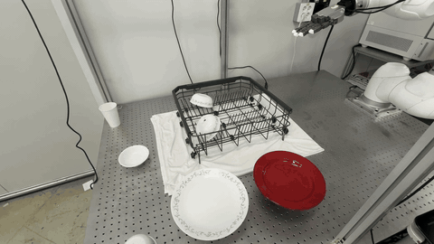
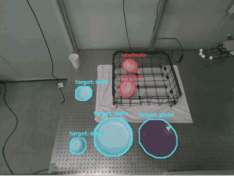

# Dish Rack Robot: 접시·그릇 → 식기 바구니

고정 카메라(D455)로 테이블 위 접시·그릇을 찾고, 두산 M1013 + Tesollo DG-5F-S 5지 핸드로 잡아
식기 바구니의 빈 칸에 넣습니다. 접시는 원하는 번호의 슬롯(핀 사이)에 꽂습니다.

| 로봇 (6배속) | 인식 화면 (6배속) |
|---|---|
|  |  |

## 한 일

- **인식**: YOLOE로 접시·그릇을 찾고 깊이로 위치를 잽니다. 바구니 칸이 비었는지와 이미 꽂힌 접시(장애물)도 봅니다.
- **파지**: 물체 위치에 맞춘 팔 접근 경로와 5지 핸드 힘 파지를 씁니다.
- **손 안 자세 측정**: 들어 올린 뒤 고정 카메라로 손 안 접시 자세를 측정합니다.
- **슬롯 삽입**: 실기 성공 1회를 정답 경로로 삼아 목표 슬롯까지 옮겨 재생하고, 작은 보정과 IK로 관절 경로를 만듭니다. 결과는 목표 슬롯 ±1칸입니다.
- **학습 정책**: Isaac Lab에서 꽂힌 접시 점군을 목표로 PointNet PPO를 학습했습니다. 시뮬 물리 재생 성공률이 43.9 %(P 제어기)에서 81.2 %로 올랐고, 실기 삽입에도 성공했습니다.
- **그리퍼 버전**: Robotiq 2F-85와 FoundationPose 6D 추정, BC 파지로 같은 작업을 했습니다.

## 실행

```bash
bash calibration/run.sh connect        # 터미널 1: 로봇 연결
bash tesollo/demo_plates.sh            # 터미널 2: 접시 2개 연속 (빨강 → 4번, 흰 → 10번 슬롯)
```

## 구조

| 폴더 | 내용 |
|---|---|
| `tesollo/` | 핸드 시연: 인식 → 팔 → 손 → 바구니 삽입 |
| `calibration/` | 카메라·로봇·바구니 공용 코드, 그리퍼 파이프라인, 테스트 |
| `rl/` | Isaac Lab 시뮬, 점군 삽입 정책 학습 |
| `IL/` | 그리퍼 BC 데이터 수집 |
| `experiments/` | 측면 카메라, 슬롯 CNN, 손 안 측정, 계획기 비교 |
| `real_time_project/`, `ros2_ws/` | YOLOE + FoundationPose 실시간 6D 추정, ROS 2 브리지 |
| `collab/` | 작업 기록 |

환경: Ubuntu 24.04, ROS 2 Jazzy, conda `foundationpose` (`conda env create -f environment.yml && bash build_all.sh`).
